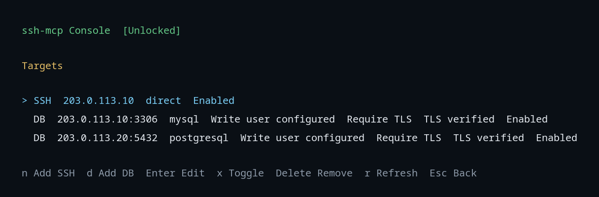
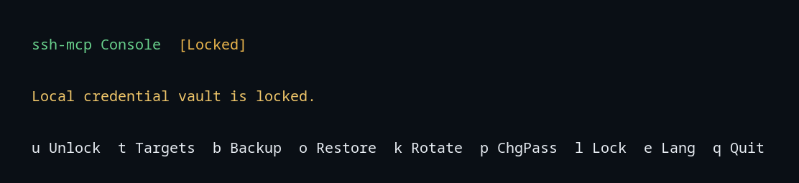
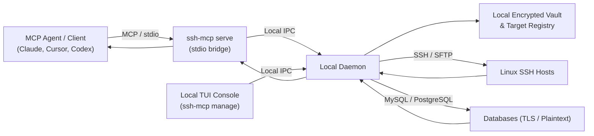

# ssh-mcp

[](LICENSE)
[](https://modelcontextprotocol.io/)

[English](README_EN.md) | [中文说明](README.md)

> **Fork notice (unrestricted branch)**: This branch deletes every fixed hard-stop rule. Any command or SQL that does not match the per-target command blacklist is dispatched for real. It is meant for a **single-operator, private, mistake-tolerant** environment, does not follow or merge upstream, and is unsuitable for shared or multi-tenant use. The safety contract now lives in the instructions returned to the agent (`mcpInstructions` and `describe_target_capability.safety_notice`) plus the per-target regex blacklist. Use upstream if you want the interception model.

> **No prebuilt binaries or Release artifacts are published for this branch**, and the release workflow is disabled on it. Build from source: `make build` (output in `bin/ssh-mcp`, Go 1.26.5 or newer required) or `go build -o bin/ssh-mcp ./cmd/ssh-mcp`. The upstream AI install prompt points at upstream releases and **does not apply here**.

**Local SSH & Database MCP Server for AI Agents (unrestricted fork)**

`ssh-mcp` is a secure, local [Model Context Protocol (MCP)](https://modelcontextprotocol.io/) server that bridges AI coding assistants (Claude Desktop, Cursor, Codex CLI, Cline, Windsurf, etc.) to your Linux SSH hosts, MySQL/MariaDB, and PostgreSQL databases via **MCP over stdio**.

It enables AI agents to execute troubleshooting commands, inspect log files, query databases, and deploy application binaries safely—**without ever exposing passwords or private keys to the LLM, and without granting unchecked access to your infrastructure.**

> [!IMPORTANT]
> `ssh-mcp` is **100% local-first**. It is not a cloud proxy and never listens on open HTTP/TCP network ports. Target credentials, host fingerprints, and authorization policies are managed exclusively by a local daemon and configured through an interactive local Terminal User Interface (TUI).

---

## Console Preview


*Local TUI management console (demonstration data).*


*Local master password unlock screen protecting the credential vault.*

---

## Why ssh-mcp? (Security Architecture)

Giving an LLM terminal access is dangerous: a single hallucination or prompt injection can result in `rm -rf /`, dropped production databases, or leaked credentials. **This fork deliberately does not try to prevent that with local command rules.** It removes every fixed hard-stop rule and moves the safety contract into the instructions returned to the agent, plus the per-target command blacklist you configure yourself.

> [!WARNING]
> In this branch `run_ssh`, `execute_ssh_session`, `run_sql`, and `deploy_ssh_binary` dispatch whatever the agent submits. There is no `format_or_partition` / `base_system_tree_destruction` / `opaque_shell_effect` / `unregistered_remote_hop` / `unconditional_write` interception. Use it only in a private, single-operator environment where a mistake is survivable.

### What still protects you

1. 🛡️ **Zero credential exposure**: Plaintext passwords, master passwords, and database credentials stay in the local encrypted vault. The AI agent and MCP client never see them.
2. 🎯 **Registered targets only**: The agent cannot invent hosts. `target` must be an enabled entry registered in the local TUI, and SSH host keys are pinned on every connection.
3. 🧭 **Explicit, honest declarations**: `describe_target_capability` returns `execution_policy: "unrestricted"` and a `safety_notice` list; an empty `absolute_prohibitions` array is reported as empty rather than implying rules that do not exist.
4. 📦 **Atomic, verified deployments**: `deploy_ssh_binary` verifies size and SHA-256, stages a temporary file, backs up an existing target, then activates. A missing target is created; a missing parent directory is refused. Ambiguous outcomes are reported as `outcome_unknown` and never auto-retried.
5. 🔒 **Untrusted remote output isolation**: Remote stdout/stderr and query results are always flagged `untrusted_remote_output`, so remote text cannot act as local instructions.

### Comparison: this fork vs. upstream ssh-mcp

| Dimension | Upstream `ssh-mcp` | This fork |
| :--- | :--- | :--- |
| **Credential Handling** | Zero-exposure local encrypted vault | Same |
| **Host Key Verification** | Pinned and verified | Same |
| **Blast Radius Protection** | 11 hard-coded pre-dispatch guardrails | **None enforced locally; relies on agent instructions and user confirmation** |
| **Target Boundary** | Registered targets; nested hops blocked | Registered entry targets only; **nested hops from inside a command are not inspected** |
| **Database Safeguards** | Segregated read/write accounts + semantic guardrails | Segregated read/write accounts; **no semantic guardrails** |
| **File Deployment** | Pre-flight SHA-256 + atomic swap + auto-backup | Same, plus creating a missing target file |
| **Custom Restrictions** | Per-target regex command blacklists | Same (the only local interception that remains) |

---

## Architecture & How It Works



- **`serve`**: The stdio MCP bridge invoked by your AI client. It automatically spawns or connects to the local daemon via OS-level IPC (Unix socket or named pipe).
- **`manage`**: Opens the interactive TUI console to set the master password, register hosts, and test connections.
- **Local Daemon**: Controls the encrypted vault, validates pre-dispatch safety rules, pins SSH host keys, and brokers all connections.

---

## Quickstart

### Option 1: AI-Assisted Automated Setup

Copy and paste the following instruction into any AI agent with terminal execution capabilities (e.g., Claude Code, Cursor terminal, Codex CLI):

```text
Please download the latest prebuilt release of ssh-mcp for the current operating system and architecture from https://github.com/lswzw/ssh-mcp/releases/latest. Place the binary in a permanent path (e.g., ~/.local/bin or current project bin/) and register it as an MCP stdio server with command argument "serve". Verify the MCP tool list once registered. If master password setup, target registration, or SSH host key confirmation is required, prompt me to complete it in the local TUI console.
```

### Option 2: Manual Installation & Build

#### Prerequisites
- Local OS: Linux, macOS, or Windows.
- Go `1.26.5` (if compiling from source).
- An MCP-compatible client supporting stdio servers (Claude Desktop, Cursor, Codex CLI, etc.).
- A terminal with interactive TTY support for initial setup.

#### 1. Build the Binary
```bash
git clone https://github.com/lswzw/ssh-mcp.git
cd ssh-mcp
make build
```
The compiled binary will be placed at `./bin/ssh-mcp` (or `./bin/ssh-mcp.exe` on Windows).

#### 2. Configure Targets in the TUI Console
Launch the local console:
```bash
./bin/ssh-mcp manage
```
Follow the on-screen keys:
1. Press `u` to set a master password and unlock the credential vault (this initializes the local database on first run).
2. (Optional) Press `e` on the dashboard to toggle between English and Chinese interface language. Your preference is automatically persisted in the local database.
3. Press `t` to open the Targets list.
4. Press `n` to add an SSH host, or `d` to add a database target.
5. Enter target credentials and press `Ctrl+S`. `ssh-mcp` will test connectivity.
6. For SSH hosts, verify the displayed host fingerprint and press `y` to confirm and pin it.
7. Press `Esc` to return and `q` to exit.

---

## MCP Client Configuration

Connect `ssh-mcp` to your favorite MCP client using the standard stdio contract:

- **Transport**: `stdio`
- **Command**: `/absolute/path/to/bin/ssh-mcp`
- **Arguments**: `["serve"]`

### Claude Desktop
Add the following to your `claude_desktop_config.json`:
- **macOS**: `~/Library/Application Support/Claude/claude_desktop_config.json`
- **Windows**: `%APPDATA%\Claude\claude_desktop_config.json`
- **Linux**: `~/.config/Claude/claude_desktop_config.json`

```json
{
  "mcpServers": {
    "ssh-mcp": {
      "command": "/absolute/path/to/ssh-mcp/bin/ssh-mcp",
      "args": ["serve"]
    }
  }
}
```

### Cursor / VS Code (Cline, Roo Code)
Configure as a custom stdio MCP server:
```json
{
  "mcpServers": {
    "ssh-mcp": {
      "command": "/absolute/path/to/ssh-mcp/bin/ssh-mcp",
      "args": ["serve"]
    }
  }
}
```

### Codex CLI
```bash
codex mcp add ssh-mcp -- "$PWD/bin/ssh-mcp" serve
codex mcp get ssh-mcp
```

*(Optional)* If the local daemon needs to open an external terminal window for interactive unlocking during agent sessions, specify the terminal launcher:
```bash
# Example for Linux GNOME environments
codex mcp add ssh-mcp --env SSH_MCP_TERMINAL=gnome-terminal -- "$PWD/bin/ssh-mcp" serve
```

---

## Example AI Prompts

Once registered, you can direct your AI agent to use `ssh-mcp`:

```text
Use ssh-mcp to list registered targets, check available disk space on the production server (203.0.113.10), and summarize which directories consume the most storage.
```

```text
Using ssh-mcp, query the replica database for the top 5 slowest queries recorded in the slow query log table today.
```

---

## Tool Reference Overview

`ssh-mcp` exposes a concise, powerful set of MCP tools:

| Tool Name | Scope | Description |
| :--- | :--- | :--- |
| `list_targets` | Discovery | Lists registered SSH and database targets with status and capabilities. |
| `describe_target_capability` | Discovery | Inspects allowed operations (file transfer, writable DB, session support). |
| `run_ssh_command` | SSH Execution | Executes a non-interactive Linux command on a target host; only the per-target blacklist can stop it. |
| `create_ssh_work_session` | SSH Session | Initializes a dedicated working session maintaining remote state/directory. |
| `run_ssh_session_command` | SSH Session | Runs a command inside an active SSH working session. |
| `close_ssh_work_session` | SSH Session | Explicitly closes an active working session. |
| `read_ssh_file` | SFTP / File | Securely reads single regular files (logs, configs) with path normalization. |
| `deploy_ssh_binary` | SFTP / Deploy | Atomic binary deployment with SHA-256 pre-check and auto-rollback backup. |
| `query_database` | SQL | Executes read-only or authorized write queries on MySQL/MariaDB or PostgreSQL. |

For detailed parameters, schemas, and return formats, see [MCP Tools Reference](docs/en/mcp-tools.md).

---

## Supported Environments & Scope

| Category | Supported Features & Limits |
| :--- | :--- |
| **Local Host OS** | Linux (x86_64, arm64), macOS (Apple Silicon, Intel), Windows (x86_64) |
| **Remote SSH Targets** | Linux OS semantics; IP address targets; password authentication; pinned host fingerprints |
| **Database Targets** | MySQL 5.7+ / 8.0+, MariaDB 10.3+, PostgreSQL 12+; TLS-verified or legacy plaintext |
| **Transport** | MCP stdio; local inter-process communication via Unix domain sockets / named pipes |
| **Out of Scope** | SSH private keys/agent forwarding, remote Windows/macOS semantics, interactive TTY, dynamic SSH tunnels (`-D`) |

---

## English Documentation

- [English Documentation Index](docs/en/README.md)
- [Quickstart Guide](docs/en/quickstart.md)
- [Installation & Runtime Guide](docs/en/installation.md)
- [Target & Vault Configuration](docs/en/configuration.md)
- [MCP Tools Reference](docs/en/mcp-tools.md)
- [Security Model & Guardrails](docs/en/security-model.md)

*(For Chinese documentation, please refer to [docs/README.md](docs/README.md))*

---

## Contributing & Security

- Contributions are welcome! Please read [CONTRIBUTING.md](CONTRIBUTING.md) before submitting Pull Requests.
- For security vulnerabilities, please refer to our [Security Policy](SECURITY.md) and report via GitHub Private Vulnerability Reporting.

---

## License

This project is licensed under the [GNU General Public License v3.0](LICENSE).
